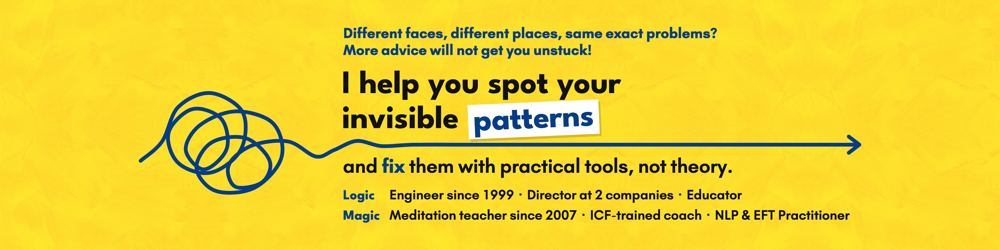

# Vivek M Agarwal

I've written code since 1999, and I've taught meditation and yoga since 2007. I've been a director at two companies: Director of Curriculum & Pedagogy at Masai School, and now Director of Learning & Development at Axelerant, where I lead engineers and educators. I'm also an ICF-trained coach and an NLP Practitioner.

The two halves meet in one idea I call Logic + Magic. First, understand in plain logic why your mind does what it does. Then use a short, practical tool that changes how you feel in a minute or two. I'm writing a book on it, *The Overthinking Elephant*.

## What I've built

- **[EDodo.app](https://edodo.app/)**: a live learning platform with books, courses and free classroom tools. I designed and built it myself.
- **13 open-source npm packages**, with more than 90,000 downloads in all (npm, November 2026).
- **[strapi-plugin-custom-api](https://github.com/vivmagarwal/strapi-plugin-custom-api-builder)**: a visual API builder for Strapi, with more than 49,000 downloads since 2022. I also wrote Strapi's official tutorial on custom API endpoints (2022).
- **[planrails](https://www.npmjs.com/package/planrails)**: a Claude Code plugin that keeps long AI coding plans on track and asks for proof before a task counts as done.
- **[edododraw](https://www.npmjs.com/package/edododraw)** and **[edodo-write](https://www.npmjs.com/package/edodo-write)**: diagrams as code with a hand-drawn look, and a Markdown-first editor.
- I build with AI coding agents every day: 9,457 GitHub contributions in 2026 so far, most of them in private repos.

## If you feel stuck

Different faces, different places, the same problems: overthinking, putting things off, holding back. I help you spot your invisible patterns and fix them with practical tools, not theory. If that sounds like you, follow me here or [connect with me on LinkedIn](https://www.linkedin.com/in/vivmagarwal/).
